# Hearth

A small, self-hosted planner for a shared home: the chores, the grocery list, and who did what this week. Made for small groups or families living together who want something simpler than a project tool.

<p align="center">
  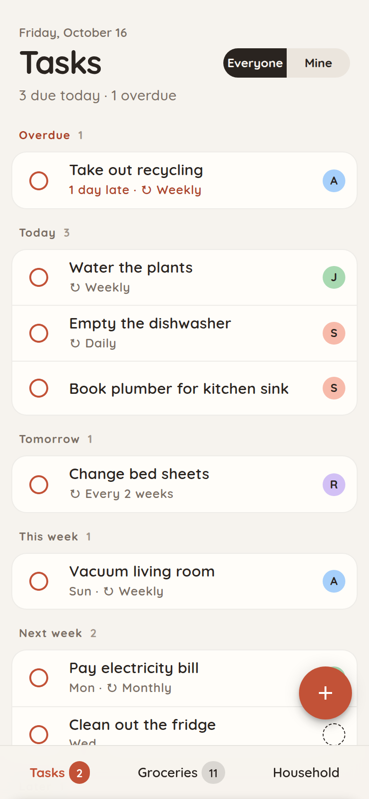
  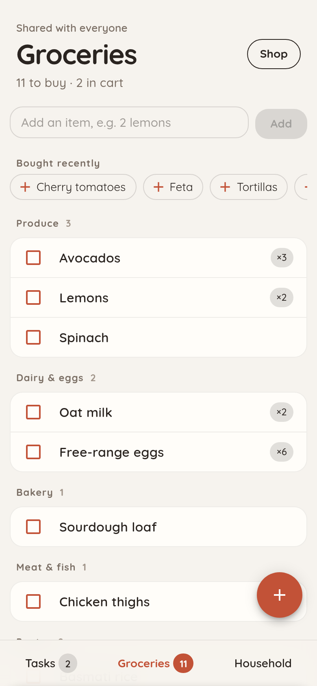
  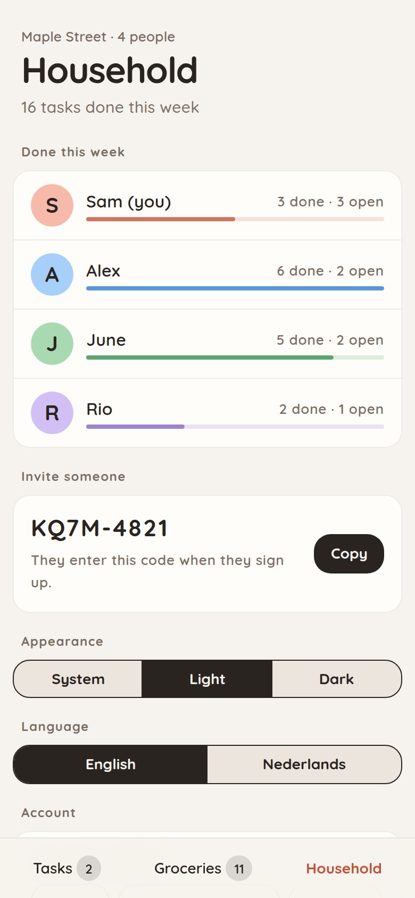
</p>

## Features

### Tasks

- Grouped by when they're due: **Overdue**, **Today**, **Tomorrow**, **This week**, **Next week**, **Later** and **Someday**. Weeks are calendar weeks, starting on Monday unless the admin picks another day.
- Give a task to someone, or to anyone. Switch between everyone's tasks and only yours.
- Pick when: today, tomorrow, next week, no date, or any day from a calendar.
- Repeating chores (daily, weekly, every two weeks, monthly) move to their next date when you tick them off, counted from the day you did them.
- Every change shows a toast with **Undo**.

<p align="center">
  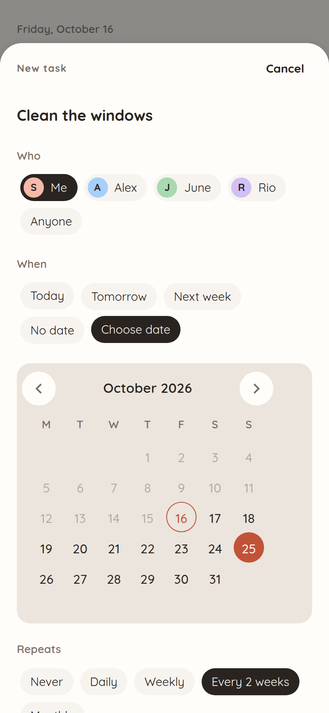
  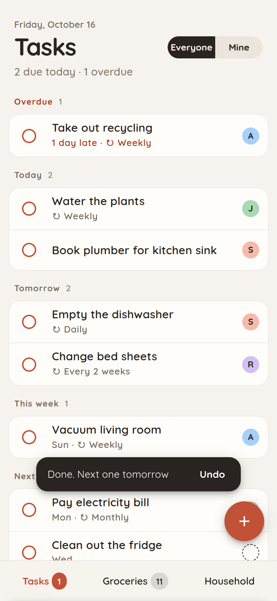
  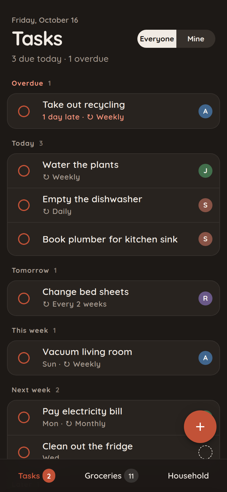
</p>

### Groceries

- One shared list, grouped by aisle. The aisle is guessed from the name: "Oat milk" goes to Dairy & eggs.
- Quick add understands quantities, like `2 lemons` or `3x eggs`. Adding something that's already on the list raises its quantity instead.
- **Bought recently** puts last trip's items one tap away.
- **Shop** mode has bigger rows and a progress bar. **Finish trip** clears the cart.

<p align="center">
  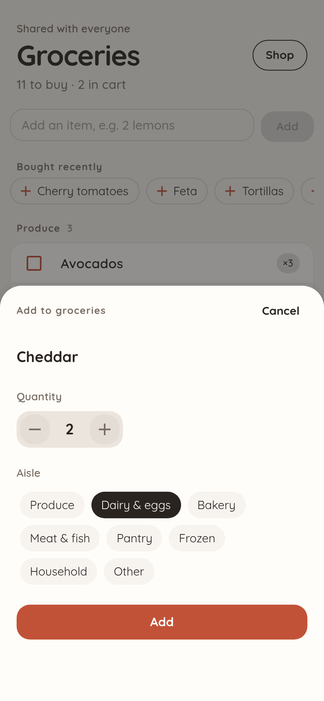
  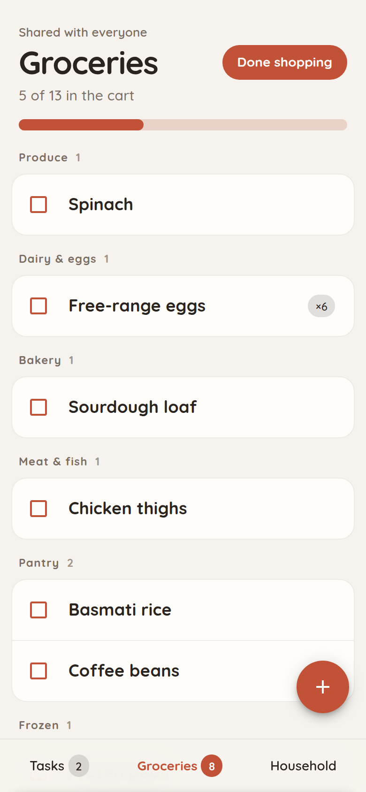
</p>

### Household

- What everyone did this week, counted from the day the admin picked as the start of the week.
- Others join with the household's invite code.
- Light, dark, or follow the system.
- English or Dutch, chosen per person. The choice follows you to other devices.
- The admin can remove members, replace the invite code, choose the day weeks start on, and make API keys for automations.

<p align="center">
  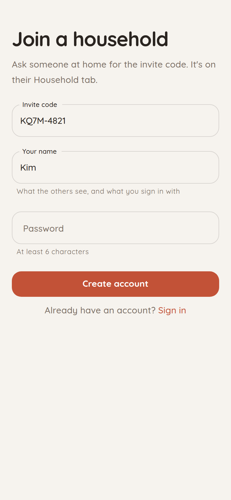
  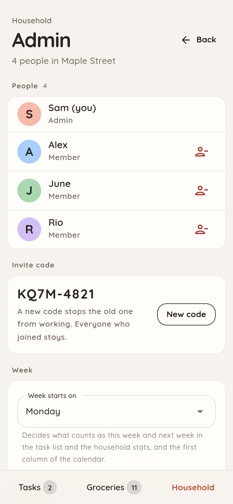
</p>

## How it works

- Every account belongs to one household, and everything in the app belongs to that household.
- The first start creates the admin account and the household from your settings. Everyone else signs up with the invite code from the Household tab.
- Sign-ins last 30 days. Each request is checked against the database, so a removed account is signed out straight away. Changing your password signs you out on your other devices.
- Guessing is slowed down: each username gets 10 sign-in tries, then one more every 6 minutes, and all usernames together get 30 a minute. Signing up allows 10 new accounts, then one more every 6 minutes, so invite codes can't be guessed either.
- "Today" comes from each person's own device, so due dates are right in every time zone.
- There's no live sync: the app picks up other people's changes every 30 seconds (new members and this week's stats too), and after every change you make.

Built with ASP.NET Core and PostgreSQL for the API, and Blazor WebAssembly with [MudBlazor](https://mudblazor.com) for the app.

## Self-hosting

Hearth runs as three containers: Postgres, the API and the app. The images are on GitHub's registry, so all you need is [`docker-compose.yml`](docker-compose.yml) and your settings. Start it with Docker Compose or add it to Portainer as a stack, whichever you prefer.

### Settings

Both ways use the same settings. [`example.env`](example.env) has them all:

| Setting | What it's for |
|---|---|
| `POSTGRES_PASSWORD` | Database password. |
| `JWT_KEY` | Signs sign-ins. At least 32 random bytes: `openssl rand -base64 32`. Changing it signs everyone out. |
| `ADMIN_SEED_USERNAME` | The first account, which is the admin. Default `admin`. |
| `ADMIN_SEED_PASSWORD` | Its password. Change it after signing in. Without one, no admin is made and nobody can sign in; the API log says so. |
| `HOUSEHOLD_NAME` | The household's name. Default `Home`. |
| `WEB_URL` | The address people open the app on, without a trailing slash. |
| `API_URL` | Where the app finds the API. Leave it empty when both are on one domain (see [Put it on your domain](#put-it-on-your-domain)). |

The admin account and household are only created while there is no admin yet. Changing these later doesn't change an existing account.

### With Docker Compose

You need a machine with Docker and Docker Compose. In a new folder, download the compose file and the example settings:

```bash
curl -O https://raw.githubusercontent.com/jordivandijk/hearth-household-planner/main/docker-compose.yml
```

```bash
curl -o .env https://raw.githubusercontent.com/jordivandijk/hearth-household-planner/main/example.env
```

Fill in `.env`, then start it:

```bash
docker compose up -d
```

### With Portainer

1. Go to **Stacks → Add stack** and name it, for example `hearth`.
2. Choose **Web editor** and paste in [`docker-compose.yml`](docker-compose.yml). Or choose **Repository** with `https://github.com/jordivandijk/hearth-household-planner` and compose path `docker-compose.yml`, so the stack picks up changes to the file.
3. Under **Environment variables**, add the settings. **Load variables from .env file** takes a filled-in copy of [`example.env`](example.env).
4. Choose **Deploy the stack**.

The API creates and updates its database tables on startup.

### Put it on your domain

The app listens on port 5224 and the API on 5160. One domain is enough for a reverse proxy in front, because the API's addresses all start with `/api/`. With [Caddy](https://caddyserver.com), which also takes care of HTTPS:

```caddyfile
hearth.example.com {
	handle /api/* {
		reverse_proxy localhost:5160
	}
	handle {
		reverse_proxy localhost:5224
	}
}
```

Then `WEB_URL` is `https://hearth.example.com` and `API_URL` stays empty. When the proxy runs on the same machine, you can change the ports to `"127.0.0.1:5160:8080"` and `"127.0.0.1:5224:80"`, so they can only be reached through it.

<details>
<summary>Without a reverse proxy, on your home network</summary>

Set:

- `API_URL` to `http://<server-ip>:5160`
- `WEB_URL` to `http://<server-ip>:5224`

Open `http://<server-ip>:5224`. Without HTTPS, passwords travel unencrypted and the invite code's **Copy** button doesn't work, so use this only on a network you trust.

</details>

### Sign in

Open the app and sign in with the admin account. To invite others, send them the code on the **Household** tab. They choose **Create an account** on the sign-in page and enter it there.

### Updating

Every change to `main` builds new images, tagged `stable`. With Docker Compose, from the folder with `docker-compose.yml`:

```bash
docker compose pull
```

```bash
docker compose up -d
```

In Portainer, open the stack and choose **Update the stack** with **Re-pull image and redeploy** switched on.

### Backups

Everything is in the Postgres database. To make a dump, from the folder with `docker-compose.yml`:

```bash
docker compose exec -T postgres pg_dump -U postgres -Fc household > hearth-$(date +%F).dump
```

To restore one:

```bash
docker compose exec -T postgres pg_restore -U postgres -d household --clean --if-exists < hearth-2026-10-15.dump
```

With Portainer, use `docker exec -i hearth-postgres-1` (your stack's name, then `-postgres-1`) in place of `docker compose exec -T postgres`.

## Automations

The admin can make API keys for things like [Home Assistant](https://www.home-assistant.io) or [n8n](https://n8n.io), under **Household → Admin → API keys**. The key is shown once, so copy it straight away. It starts with `hearth_`.

<p align="center">
  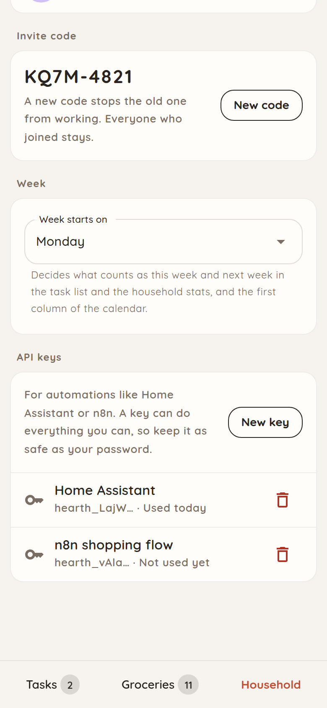
</p>

Send it with every request as a header:

```
Authorization: Bearer hearth_…
```

A key acts as the admin who made it, so it can do anything they can in the app, except manage API keys. Changing the admin's password doesn't affect their keys. Revoke a key and anything using it is refused from its next request. The list shows when each key was last used.

The API is the one the app uses, under `/api/`. Some examples:

| Request | What it does |
|---|---|
| `GET /api/groceries` | The grocery list (`items`) and recently bought items (`recents`). |
| `POST /api/groceries` with `{"name": "Oat milk", "quantity": 2}` | Adds an item, or raises its quantity when it's already on the list. |
| `GET /api/tasks` | Open tasks, and those done in the last 30 days. |
| `POST /api/tasks` with `{"title": "Water the plants", "due": "2026-10-20", "repeat": "Weekly"}` | Adds a task. `repeat` is `None`, `Daily`, `Weekly`, `Biweekly` or `Monthly`. |
| `POST /api/tasks/{id}/complete` with `{"today": "2026-10-20"}` | Ticks a task off, as the key's admin. A repeating task moves to its next date, counted from `today`. |

In development, the API explorer at `/scalar` lists every request.

<details>
<summary>Home Assistant example</summary>

In `secrets.yaml`:

```yaml
hearth_auth: "Bearer hearth_…"
```

In `configuration.yaml`, a sensor with the number of groceries still to buy, and an action that adds one:

```yaml
sensor:
  - platform: rest
    name: Groceries to buy
    resource: https://hearth.example.com/api/groceries
    headers:
      Authorization: !secret hearth_auth
    value_template: "{{ value_json['items'] | rejectattr('inCart') | list | count }}"
    scan_interval: 300

rest_command:
  hearth_add_grocery:
    url: https://hearth.example.com/api/groceries
    method: post
    headers:
      Authorization: !secret hearth_auth
    content_type: application/json
    payload: '{"name": "{{ name }}"}'
```

</details>

<details>
<summary>n8n example</summary>

In an **HTTP Request** node, set **Authentication** to **Generic Credential Type**, then **Bearer Auth**, and paste the key as the token.

</details>

## Development

You need the .NET 10 SDK, and Docker for a local database.

Get the code:

```bash
git clone https://github.com/jordivandijk/hearth-household-planner.git
```

Start a database:

```bash
docker run -d --name hearth-dev-db -e POSTGRES_PASSWORD=postgres -p 55433:5432 postgres:17-alpine
```

Create `HouseholdPlanner.Api/appsettings.Development.json` (it's git-ignored):

```json
{
  "AdminSeed": { "Username": "admin", "Password": "admin", "HouseholdName": "Home" },
  "ConnectionStrings": { "DefaultConnection": "Host=localhost;Port=55433;Database=household;Username=postgres;Password=postgres" },
  "Jwt": { "Key": "<at least 32 random bytes, e.g. from openssl rand -base64 32>" }
}
```

Run the API (http://localhost:5160, with an API explorer at `/scalar`):

```bash
dotnet run --project HouseholdPlanner.Api
```

And the app (http://localhost:5224):

```bash
dotnet run --project HouseholdPlanner.Web
```

Run the tests:

```bash
dotnet test HouseholdPlanner.slnx
```

After changing the data model, add a migration from the `HouseholdPlanner.Api` folder:

```bash
dotnet ef migrations add <Name> -o Data/Migrations
```

### Languages

The app's texts are in `HouseholdPlanner.Web/Resources/Strings.resx` (English) and `Strings.nl.resx` (Dutch). The API's error messages are in `HouseholdPlanner.Api/Resources/ErrorMessages.nl.resx`, keyed by their English text. The tests fail when a text is missing from a language.

To add a language, for example German:

1. Copy `Strings.nl.resx` to `Strings.de.resx` and translate it, including the day and month names.
2. Add `ErrorMessages.de.resx` the same way.
3. Add `de` to `Languages` in both `HouseholdPlanner.Web/Services/Languages.cs` and `HouseholdPlanner.Api/Models/Languages.cs`.
4. For aisle guessing, add German words to `HouseholdPlanner.Web/Services/GroceryText.cs`.

### Project layout

| Folder | What's in it |
|---|---|
| `HouseholdPlanner.Api` | The API: controllers, services, repositories, EF Core model and migrations. |
| `HouseholdPlanner.Web` | The Blazor WebAssembly app. The look comes from the MudBlazor theme in `Theme/HearthTheme.cs`. |
| `HouseholdPlanner.Api.Tests` | Tests for the API's services and request validation. |
| `HouseholdPlanner.Web.Tests` | Tests for the app's own logic, such as due dates, quick add and the 30-second refresh. |
| `docs/screenshots` | The pictures in this README. |
